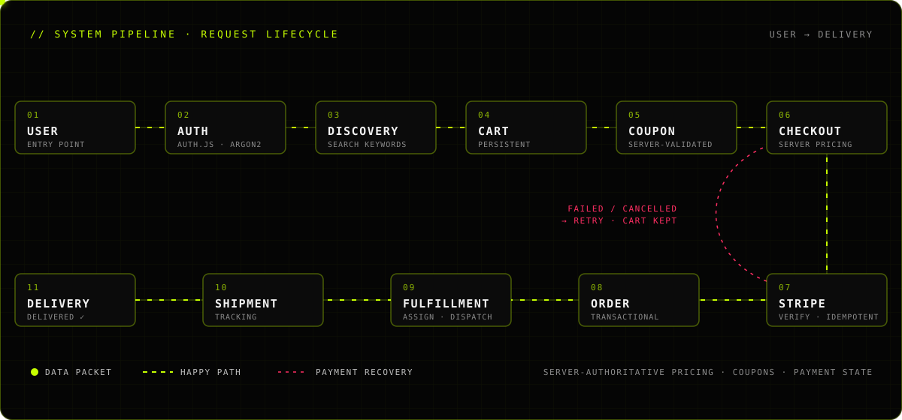
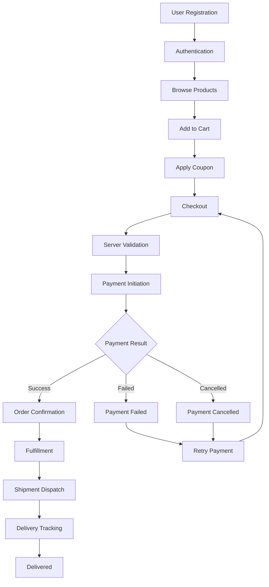
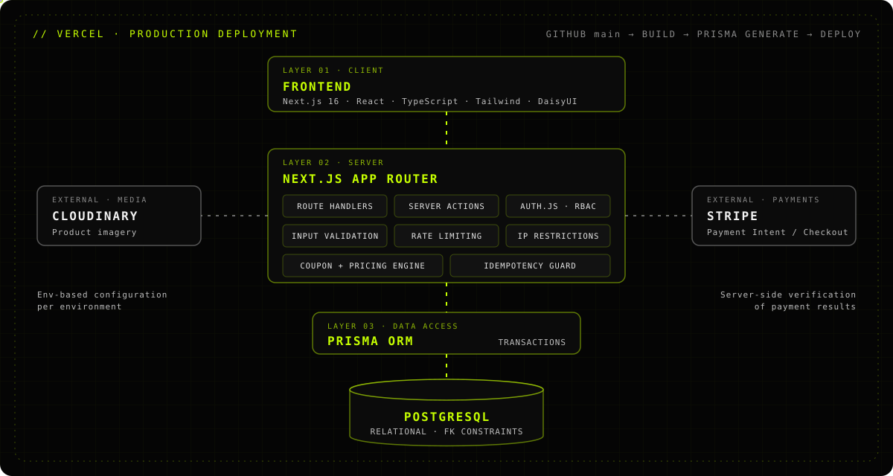
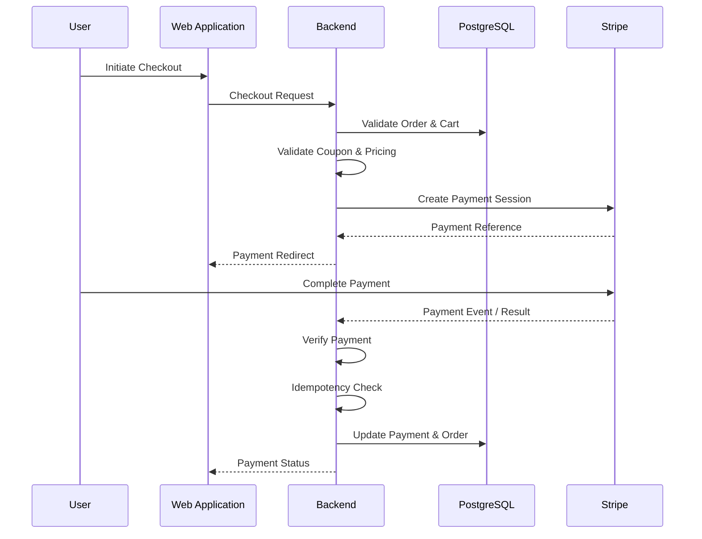

<div align="center">



<br/>

<a href="https://hyperreal.vercel.app"></a>
<a href="https://github.com/gs-shaykot/HyperReal"></a>

<br/><br/>


<sub><code>SYS://HYPERREAL</code> · <code>MODE: DARK</code> · <code>ACCENT: #C6FF00</code> · <code>ENGINEERING BEYOND THE INTERFACE</code></sub>

</div>


## `01` // TRANSMISSION

> A futuristic, full-stack e-commerce platform engineered around secure transactions, intelligent product discovery, operational order management and an immersive shopping experience.

HyperReal is a full-stack e-commerce platform built to explore real-world software engineering challenges **beyond conventional CRUD**. It combines a futuristic storefront with a commerce backend, administrative operations, payment processing, fulfillment workflows, shipping management and security-oriented engineering.

<table>
<tr>
<td width="50%" valign="top">

**Primary engineering focus**

- Secure authentication & authorization
- Transactional integrity
- Payment lifecycle management
- Idempotent operations
- Inventory & order consistency

</td>
<td width="50%" valign="top">

&nbsp;

- Coupon eligibility & validation
- Fulfillment & shipment tracking
- Administrative access control
- API protection & abuse prevention
- Responsive, interactive UI engineering

</td>
</tr>
</table>


## `02` // SYSTEM PIPELINE

The centerpiece: every order travels the same server-authoritative route — from the first visit to the doorstep. Failed or cancelled payments loop back to checkout with the cart intact.

<div align="center">

</div>
 
<summary><b>▸ View as Mermaid flowchart</b></summary>




## `03` // ARCHITECTURE

<div align="center">

</div>

<table>
<tr>
<td width="33%" valign="top">

**▍ Frontend**
- Next.js 16 · React · TypeScript
- Tailwind CSS · DaisyUI
- Framer Motion / Motion *(where implemented)*
- Lucide Icons

</td>
<td width="33%" valign="top">

**▍ Backend**
- Next.js App Router
- Route Handlers
- Server Actions *(where applicable)*
- Prisma ORM · PostgreSQL

</td>
<td width="33%" valign="top">

**▍ Security**
- Auth.js / NextAuth
- Argon2 password hashing
- Role-based authorization
- Input validation & sanitization
- API rate limiting · IP restrictions
- Session management

</td>
</tr>
<tr>
<td valign="top">

**▍ Payments & Commerce**
- Stripe
- Payment Intent / Checkout integration
- Server-side payment verification
- Payment status handling
- Idempotency mechanisms

</td>
<td valign="top" colspan="2">

**▍ Infrastructure & Deployment**
- Vercel · GitHub
- Cloudinary
- Environment-based configuration
- Prisma Client generation

</td>
</tr>
</table>


## `04` // ENGINEERING MODULES

<table>
<tr>
<td width="33%" valign="top">

### 🔐 Auth & Authorization
`ARGON2` `RBAC` `SESSIONS`

Argon2-hashed passwords, authenticated sessions and server-side role checks guarding every admin operation.

</td>
<td width="33%" valign="top">

### 💳 Payment Processing
`STRIPE` `VERIFY`

Payment initiation, server-side verification, failure and cancellation handling, status tracking and retry.

</td>
<td width="33%" valign="top">

### ♻️ Idempotency
`DEDUPE` `SAFE RETRY`

Duplicate request protection so repeated payment-related calls never process twice.

</td>
</tr>
<tr>
<td valign="top">

### 🚦 Rate Limiting
`THROTTLE` `ABUSE`

Request limits protecting sensitive endpoints from excessive or abusive traffic.

</td>
<td valign="top">

### 🛰️ IP Restrictions
`POLICY` `ACCESS`

Configurable IP-based access policies for sensitive operations.

</td>
<td valign="top">

### 🧱 Transactional Integrity
`ATOMIC` `CONSISTENT`

Database transactions for critical operations and controlled state transitions — no partial business operations.

</td>
</tr>
<tr>
<td valign="top">

### 🏷️ Coupon Validation
`ELIGIBILITY` `MIN SPEND`

Visibility and validation are separate concerns; the server enforces eligibility, new-user rules and minimum spend.

</td>
<td valign="top">

### 📦 Order Management
`HISTORY` `STATUS`

Order creation, history, details, order & payment status, tracking and admin management.

</td>
<td valign="top">

### 🏭 Fulfillment
`ASSIGN` `DISPATCH`

Fulfillment records with status tracking kept separate from shipment status.

</td>
</tr>
<tr>
<td valign="top">

### 🚚 Shipment Tracking
`TRACKING` `INTL`

Shipment records, dispatch, delivery updates and international shipping support.

</td>
<td valign="top">

### 🔎 Product Search
`KEYWORDS` `MATCHING`

Custom `searchKeywords` per product so related terms surface the right item.

</td>
<td valign="top">

### 🖥️ Admin Dashboard
`PROTECTED` `OPS`

Products, orders, fulfillment, shipments and coupons behind role-protected routes.

</td>
</tr>
</table>


## `05` // CODE ARCHITECTURE

> Representative, simplified sketches of how the workflows are structured — not verbatim source.

<table>
<tr>
<td width="50%" valign="top">

**`checkout` · server-authoritative pricing**

```ts
// Route Handler — illustrative
export async function POST(req: Request) {
  const session = await auth();
  if (!session) return unauthorized();

  const body = schema.parse(await req.json());

  // never trust client totals
  const cart = await getCart(session.user.id);
  const coupon = await validateCoupon(
    body.code, session.user, cart.subtotal,
  );
  const total = priceOrder(cart, coupon);

  return createPayment(total, {
    idempotencyKey: body.idempotencyKey,
  });
}
```

</td>
<td width="50%" valign="top">

**`payment` · verify → idempotent update**

```ts
// illustrative
async function confirmPayment(ref: string) {
  const result = await stripe.verify(ref);

  await prisma.$transaction(async (tx) => {
    const payment = await tx.payment
      .findUnique({ where: { ref } });

    // repeated request → no-op
    if (payment?.status === "PAID") return;

    await tx.payment.update({ /* status */ });
    await tx.order.update({ /* confirm */ });
  });
}
```

</td>
</tr>
<tr>
<td valign="top">

**`search` · keyword discovery**

```ts
// "Inheritance Dyper" is found by:
// pant · pants · trouser · trousers
// bottom · dyper
prisma.product.findMany({
  where: {
    OR: [
      { name: { contains: q, mode: "insensitive" } },
      { searchKeywords: { has: q.toLowerCase() } },
    ],
  },
});
```

</td>
<td valign="top">

**`coupon` · eligibility rules**

```ts
// WELCOME10 → eligible new users only
// RACE10    → independently configured rules
function isEligible(coupon, user, subtotal) {
  if (coupon.newUsersOnly && !user.isNew)
    return reject("NOT_ELIGIBLE");
  if (subtotal < coupon.minSpend)
    return reject("MIN_SPEND");
  return accept(coupon);
}
```

</td>
</tr>
</table>

<details>
<summary><b>▸ Payment processing sequence (Mermaid)</b></summary>



</details>

<details>
<summary><b>▸ Fulfillment & shipping workflow (Mermaid)</b></summary>


</details>


## `06` // INTERFACE SHOWCASE

<div align="center">

<br/>
<sub>Stylised illustrations of the interface — see the <a href="https://hyperreal.vercel.app">live demo</a> for the real thing.</sub>
</div>

<br/>

<details>
<summary><b>▸ Full storefront feature list</b></summary>

<table>
<tr>
<td width="50%" valign="top">

**Authentication & Account**
- Registration & secure login
- Password hashing · session-based auth
- Profile management
- Admin authentication & access restrictions

**Product Catalog**
- Listing, details, categories, variants, images
- Availability & pricing
- Search with keyword matching & related-keyword discovery
- Filtering & sorting · new arrivals · archival

**Shopping Cart**
- Persistent cart · quantity & variant selection
- Subtotal, coupon, discount, shipping & total calculation
- Cart preserved during payment interruptions

</td>
<td width="50%" valign="top">

**Checkout & Orders**
- Stripe checkout workflow
- Failure, cancellation & retry handling
- Order/payment association
- Order history, details, status & tracking
- Order cancellation *(where implemented)*

**Lookbook & Outfits**
- Editorial outfit collections
- Interactive, product-positioned hotspots
- Explore Look interaction & tooltips
- Direct product navigation

**User Experience**
- Dark futuristic UI with light/dark toggle
- Loading skeletons · empty & error states
- Payment success / failure / cancellation pages
- Custom animated 404

</td>
</tr>
</table>

</details>


## `07` // ADMIN CONTROL ROOM

| Module | Capabilities |
| --- | --- |
| **Products** | Create · update · delete · categories · variants · images · availability · search keywords · AI-assisted keyword generation *(where configured)* |
| **Orders** | View · inspect details · manage order status · monitor payment states |
| **Fulfillment** | Assign fulfillment · update statuses · manage dispatch · shipment tracking |
| **Coupons** | Create · discount types · eligibility rules · minimum spend · availability |
| **Access Control** | Protected admin routes · role-based access · server-side authorization |


## `08` // DATA LAYER

Prisma ORM over PostgreSQL, modelled for referential integrity and transaction-safe mutations.

```text
Users ─┬─ Carts ── Products ─┬─ Categories
       │                     ├─ Product images
       │                     ├─ Product variants
       │                     └─ Search keywords
       └─ Orders ─┬─ Order items
                  ├─ Payments
                  ├─ Coupons
                  ├─ Fulfillment records
                  └─ Shipments
```

<sub>Simplified relationship sketch. Focus: relational modelling · foreign keys · constraints · consistent order/payment relationships.</sub>


## `09` // DEPLOYMENT

| Pipeline | Production considerations |
| --- | --- |
| GitHub source control | Environment variable configuration |
| Main-branch deployment workflow | Production database connectivity |
| Vercel production deployment | Secure payment configuration |
| Automated production builds | Production authentication configuration |
| Prisma Client generation | Build-time type checking |
| TypeScript build validation | Server-side validation |


## `10` // STATUS MATRIX

<table>
<tr>
<td width="50%" valign="top">

### 🟢 Implemented
Everything documented in sections `01`–`09`, including authentication, catalog & keyword search, cart, coupon engine, Stripe checkout with failure/cancel/retry, orders, fulfillment, shipments, lookbook, admin dashboard, rate limiting, IP restrictions, transactions and idempotency.

<sub>Items marked *(where implemented)* / *(where configured)* apply only to parts of the project.</sub>

</td>
<td width="50%" valign="top">

### 🟡 Future improvements
*Not yet built:*
- Automated testing
- Payment webhook hardening
- Advanced inventory reservation
- Distributed rate limiting
- Observability & structured logging
- Background job processing
- Advanced shipment integrations
- Automated CI quality gates
- Performance optimization
- Security testing
- Monitoring & alerting

</td>
</tr>
</table>


## `11` // PHILOSOPHY

HyperReal is **not merely a storefront UI**. It demonstrates how independent systems work together — authentication, authorization, commerce, payments, database consistency, order management, fulfillment, shipping, security and user experience — with an emphasis on practical implementation, debugging, system integration and understanding a complete application across local development and production.


<div align="center">

## `>_` // DEVELOPER

<a href="https://github.com/gs-shaykot"></a>

### GS Shaykot
**Full-Stack Software Engineer** · Bangladesh

<a href="https://github.com/gs-shaykot"></a>

<br/><br/>

<sub><code>HYPERREAL — ENGINEERING BEYOND THE INTERFACE.</code></sub>

</div>
